<div align="center">

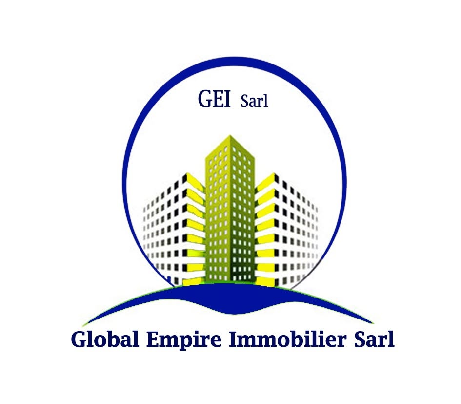

# Global Empire Immobilier · Site web et tableau de bord

**Le site officiel de GEI Sarl, promoteur et constructeur en Côte d'Ivoire,<br>avec un tableau de bord pour gérer les programmes, les actualités et les demandes des clients.**

[Voir le site en ligne](https://malickouattara125-wq.github.io/site-gei/) ·
[Lancer en local](#-lancer-le-site-et-le-tableau-de-bord) ·
[Organisation du code](#-organisation-du-dépôt)

</div>

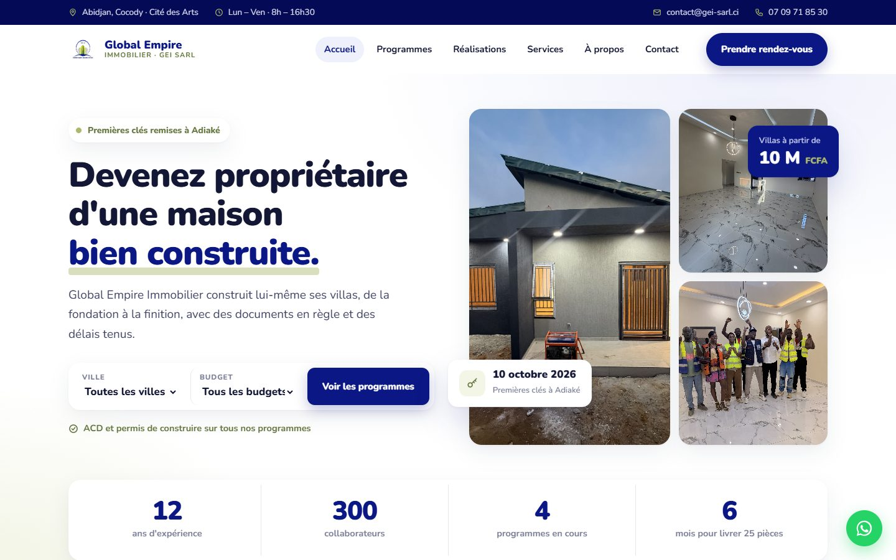

---

## 📌 En bref

| | |
|---|---|
| **Le site** | 12 pages : accueil, 4 programmes immobiliers (Adiaké, Djorobité, Bingerville, Abengourou), réalisations, services, à propos, actualités, contact. Adapté aux ordinateurs et aux téléphones. |
| **Le tableau de bord** | Une page protégée par mot de passe pour **modifier les programmes** (prix, statut, textes, photos), **publier des actualités**, **lire les demandes de contact** et **suivre les visites**. |
| **Technique** | HTML, CSS et JavaScript, sans framework. Serveur en **Node.js sans aucune dépendance** à installer. |
| **Couleurs GEI** | Bleu royal `#0A1784`, bleu nuit `#040A56`, vert olive `#ACB96A`, beige `#E9DFC4`. Police Nunito. |

---

## 🖼️ Le site

<table>
<tr>
<td width="50%">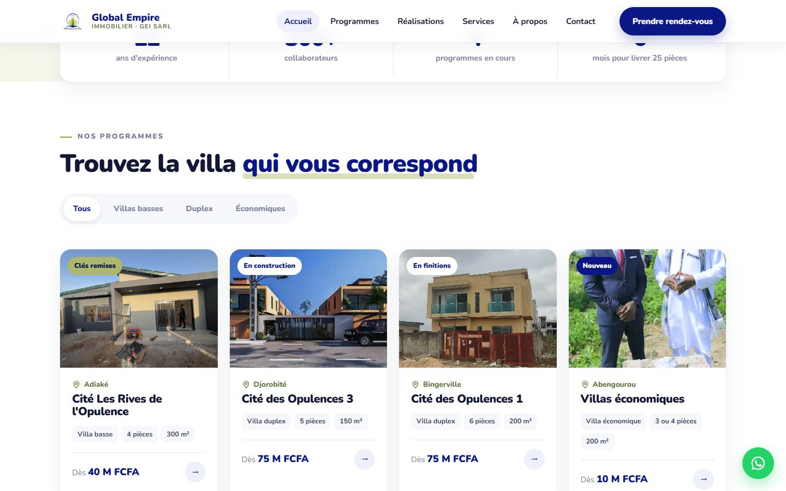<br><b>Programmes</b> : filtres par type et recherche par ville et budget.</td>
<td width="50%">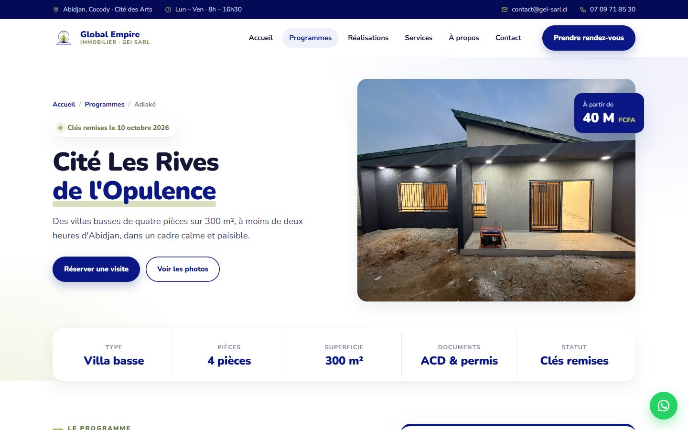<br><b>Fiche programme</b> : prix, formules, caractéristiques, réservation.</td>
</tr>
<tr>
<td>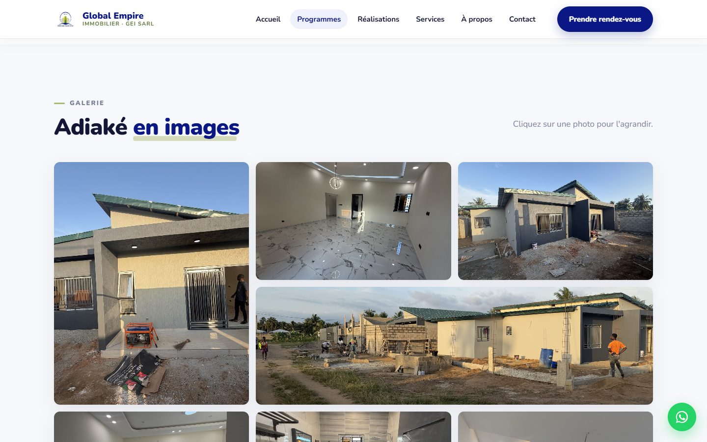<br><b>Galerie</b> : on clique sur une photo pour l'agrandir.</td>
<td align="center">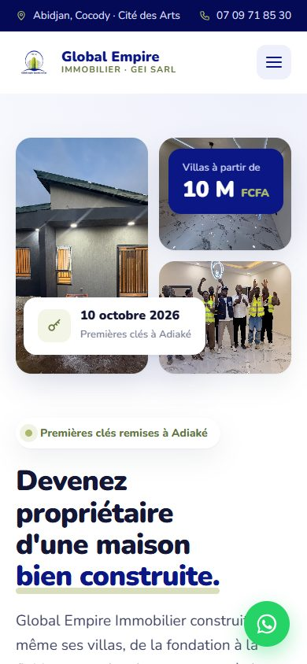<br><b>Sur téléphone</b> : menu adapté, rien ne déborde.</td>
</tr>
</table>

Chaque formulaire de contact **enregistre la demande** dans le tableau de bord, puis ouvre **WhatsApp** avec un message déjà rédigé.

---

## 🧭 Le tableau de bord

> Les captures ci-dessous utilisent des **données d'exemple** (demandes et visites fictives).

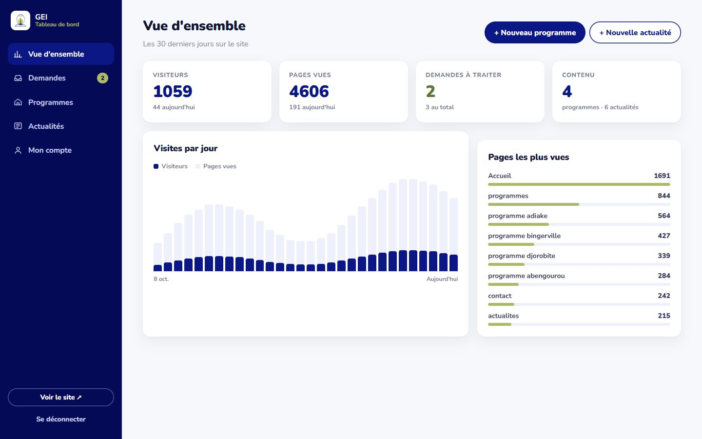

<table>
<tr>
<td width="50%">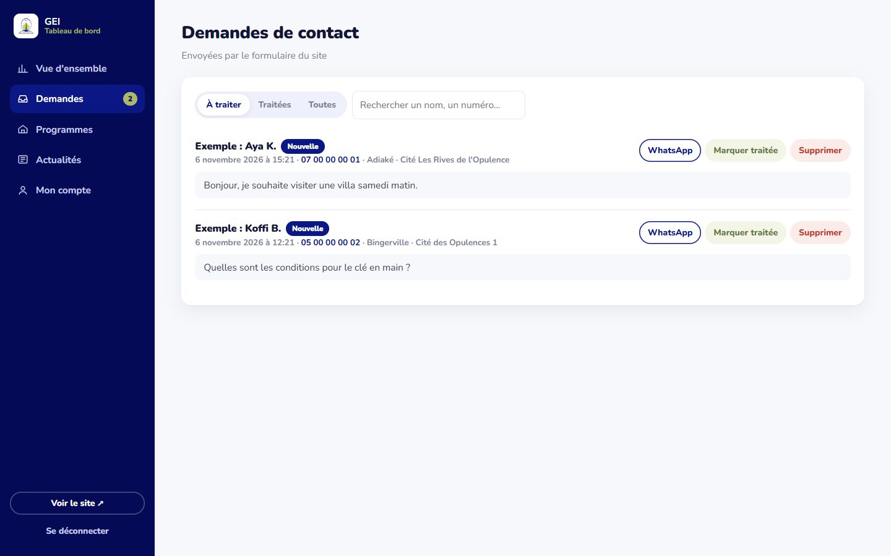<br><b>Demandes</b> : chaque message du formulaire, avec un bouton WhatsApp et « Marquer traitée ».</td>
<td width="50%">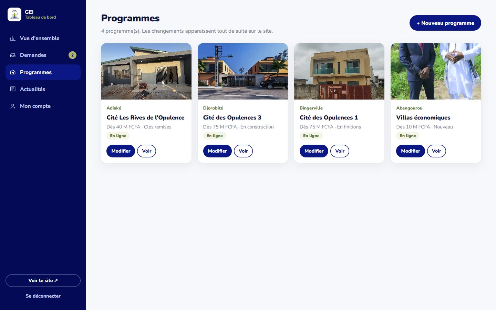<br><b>Programmes</b> : ajouter, modifier, masquer ou supprimer.</td>
</tr>
<tr>
<td>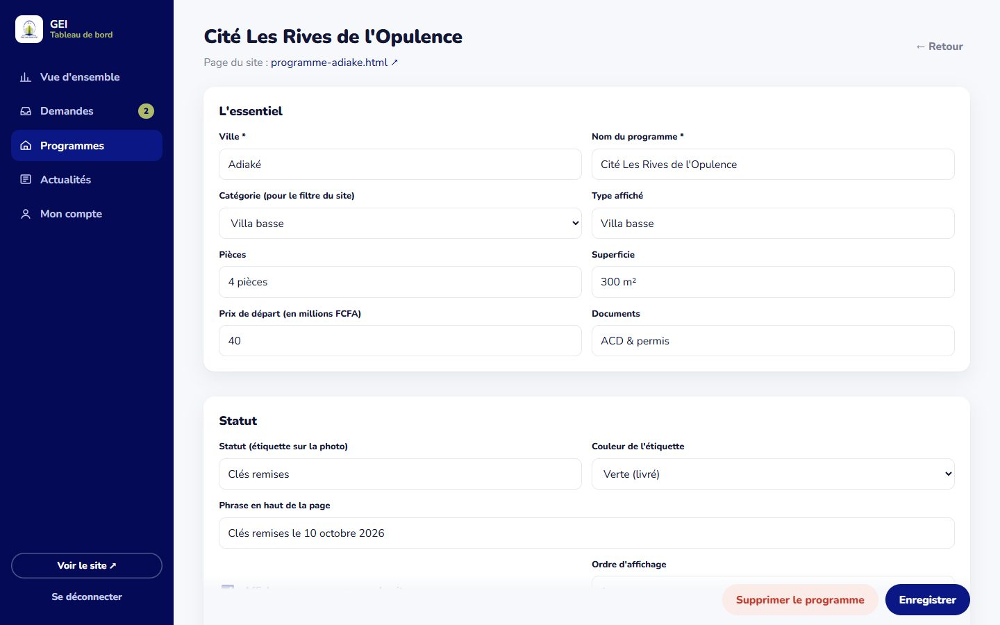<br><b>Modifier un programme</b> : prix, statut, textes, formules.</td>
<td>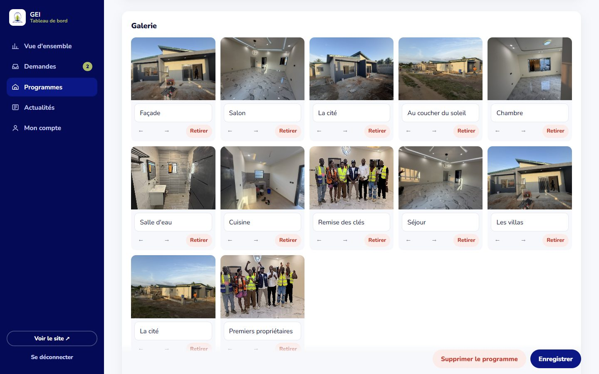<br><b>Galerie</b> : envoyer des photos, les ordonner, les légender.</td>
</tr>
<tr>
<td>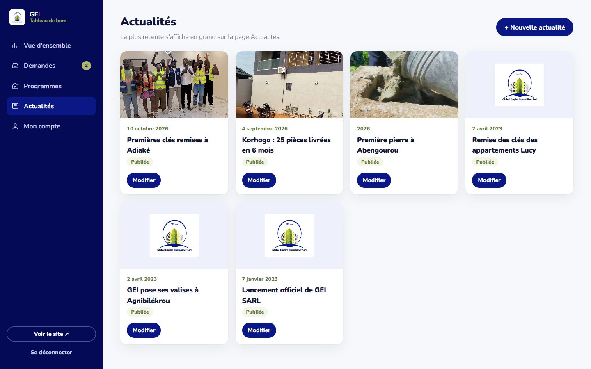<br><b>Actualités</b> : publier une nouvelle avec photo.</td>
<td>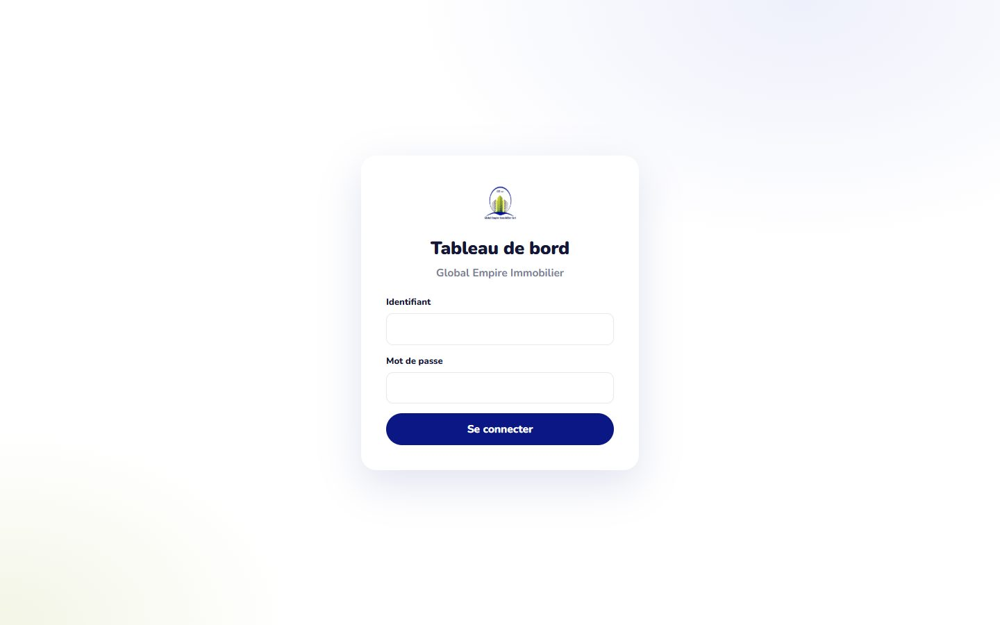<br><b>Connexion</b> : identifiant et mot de passe.</td>
</tr>
</table>

Toute modification apparaît **immédiatement** sur le site : accueil, liste des programmes, fiche et actualités.

---

## ⚙️ Comment ça marche

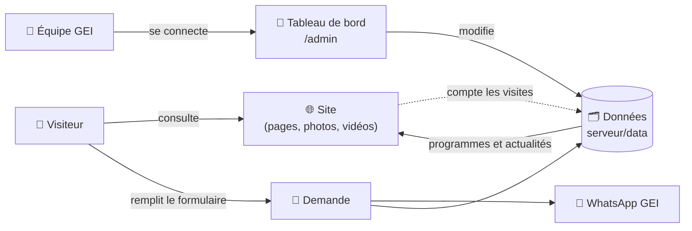

- Le **serveur** (`serveur/server.js`) affiche le site et fabrique à la volée les fiches programme, la liste des programmes et les actualités à partir des données.
- Les données sont de simples **fichiers JSON** dans `serveur/data/`. Il n'y a pas de base de données à installer.
- **Sans le serveur** (GitHub Pages, Vercel…), le site reste visible avec son contenu de départ. Le formulaire ouvre simplement WhatsApp.

---

## 🚀 Lancer le site et le tableau de bord

**Il faut seulement [Node.js](https://nodejs.org), version 18 ou plus.**

1. Télécharger le dépôt : bouton vert **Code**, puis **Download ZIP**, et décompresser.
   ```bash
   git clone https://github.com/malickouattara125-wq/site-gei.git
   ```
2. Démarrer le serveur :
   ```bash
   cd site-gei/serveur
   node server.js
   ```
   Sous Windows, on peut aussi double-cliquer sur `serveur/demarrer.bat`.
3. Ouvrir :
   - le site : **http://localhost:8765**
   - le tableau de bord : **http://localhost:8765/admin**
4. **Première connexion :** les identifiants sont créés automatiquement dans `serveur/data/premier-acces.txt`. Changez le mot de passe dans **« Mon compte »** : le fichier est alors supprimé.

---

## 📁 Organisation du dépôt

```
site-gei/
├── index.html, programmes.html, …   les 12 pages du site
├── css/v2.css                       le style (couleurs GEI, mise en page, téléphone)
├── js/v2.js                         animations, filtres, galerie, formulaire
├── assets/
│   ├── img/                         photos des programmes et logo
│   └── video/                       vidéos (visite, cérémonies, présentation)
├── docs/captures/                   captures d'écran de ce document
└── serveur/                         le tableau de bord
    ├── server.js                    le serveur (site + API)
    ├── demarrer.bat                 lancement par double-clic sous Windows
    ├── admin/                       l'interface du tableau de bord
    ├── lib/
    │   ├── auth.js                  connexion, mot de passe chiffré, sessions
    │   ├── store.js                 enregistrement des données (fichiers JSON)
    │   ├── stats.js                 comptage des visites (anonyme)
    │   └── render.js                fabrication des pages programmes et actualités
    ├── templates/layout.html        en-tête, menu et pied de page communs
    ├── seed/                        contenu de départ : 4 programmes, 6 actualités
    ├── data/        (créé au démarrage, jamais publié)   données et mot de passe
    └── uploads/     (créé au démarrage, jamais publié)   photos envoyées
```

---

## 🔒 Sécurité

- Mot de passe **chiffré** (scrypt), jamais stocké en clair. Après 5 essais ratés, la connexion est bloquée 15 minutes.
- Session par **cookie protégé** (HttpOnly, SameSite=Strict), valable 8 heures.
- Les dossiers `serveur/data` et `serveur/uploads` ne sont **jamais servis** par le site et **ne doivent jamais être publiés** : ils contiennent les coordonnées des clients et le mot de passe.
- Formulaire protégé contre les robots (champ piège et limite de 10 envois par heure).
- Photos vérifiées (vrai fichier JPEG, PNG ou WebP) et réduites à 1800 px avant l'envoi.

---

## 🌍 Mise en ligne

| Hébergement | Site | Tableau de bord |
|---|:---:|:---:|
| GitHub Pages / Vercel | ✅ | ❌ (pas de serveur) |
| Hébergeur Node.js (VPS, Render, Railway, Hostinger, o2switch…) | ✅ | ✅ |

Sur un hébergeur Node.js : envoyer le dépôt, lancer `node serveur/server.js` et activer le HTTPS.
Réglages possibles : `PORT`, `SITE_DIR`, `ADMIN_USER`, `ADMIN_PASSWORD`. Voir [`serveur/README.md`](serveur/README.md).

---

<div align="center">

**Global Empire Immobilier SARL** · Abidjan, Cocody, Cité des Arts · contact@gei-sarl.ci · 07 09 71 85 30<br>
*Votre confiance, notre engagement.*

</div>
